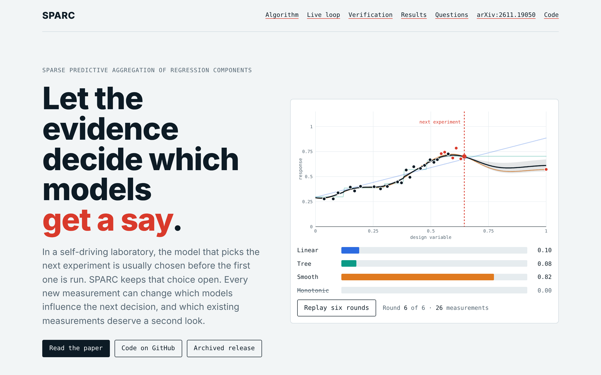
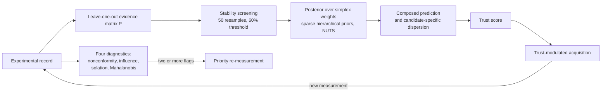

# SPARC

**Sparse Predictive Aggregation of Regression Components** — evidence-guided adaptive model composition for materials discovery.

[](https://arxiv.org/abs/2611.19050)
[](https://doi.org/10.5281/zenodo.24201692)
[](LICENSE)


[](https://sissifeng.github.io/SPARC/)

In a self-driving laboratory, the model that picks the next experiment is usually chosen before the first one is run. SPARC keeps that choice open. Every new measurement can change which models influence the next decision, and which existing measurements deserve a second look.

**[Interactive explainer](https://sissifeng.github.io/SPARC/)** · **[Paper](https://arxiv.org/abs/2611.19050)** · **[Archived release](https://doi.org/10.5281/zenodo.24201692)**

## What SPARC does

- **Lets out-of-sample evidence set model influence.** Twelve candidate models in four structural families are scored on predictions for observations withheld from their fitting. A sparse posterior assigns non-negative weights that sum to one, so complementary models stay influential when the data support them.
- **Turns model disagreement into a decision signal.** The retained models can agree in one region and diverge in another. Candidate-specific dispersion and a residual scale define a trust score that modulates exploration.
- **Questions the experimental record.** Four independent diagnostics prioritize existing measurements for repetition before their repeatability is known.

## How it works



| Move | What happens |
| --- | --- |
| 1. Compete | Additive, tree-based, locally smooth and monotonic models are fitted to the same sparse record. |
| 2. Withhold | Each record is predicted by every model refitted without it, giving the evidence matrix `P[i, m]`. |
| 3. Screen | A non-negative lasso on the evidence is repeated over 50 subsamples of 80% of the records. Models selected in at least 60% of them enter the active set. |
| 4. Compose | Weights `w = abs(a) / sum(abs(a))` receive a posterior under hierarchical half-Cauchy scale priors, sampled with NUTS. |
| 5. Trust | Posterior weight draws are pushed through the retained models. Their spread at a candidate, combined with a residual scale, gives `T(x) = 1 / (1 + sqrt(u(x)^2 + u_res^2) / q)`. |
| 6. Decide | Candidates are ranked by `mean + beta * u(x) * T(x)` (confidence bound) or by a trust-scaled Thompson score. |

The [interactive explainer](https://sissifeng.github.io/SPARC/) runs these six moves live on a small one-dimensional example, with animations for each step.

## Results at a glance

Numbers are from the [paper](https://arxiv.org/abs/2611.19050). The qualifiers are part of each result.

| Test | Result | Read it with this in mind |
| --- | --- | --- |
| Prospective alkaline OER campaign | 8 of 11 recommended conditions below 300 mV at 10 mA cm⁻² (best 242 mV); 18 of 125 in the initial record | Recommendations were fixed before measurement. There was no parallel baseline arm. |
| Prospective measurement verification | All three original–repeat deviations above 130 mV were among the 7 records flagged before repetition; all 8 matched controls stayed below 42 mV | Means 76 vs 27 mV; medians 36.3 vs 32.5 mV. Descriptive, small groups. |
| Eight published datasets | R² above the value reported by the source study on 6 of 8 | Source studies used their own splits; reported values are context, not matched-split baselines. |
| Pretrained representations | Lowered R² in all six cases tested (by 11–37%) | Two datasets of 160 and 99 records. |
| Finite-pool search | Near-optimum after 66 vs 113 (GP) and 126 (RF) evaluations for Ru dissolution; 16 vs 39 and 76 for polymer HER | One initialization per task: case studies. |
| Controlled extrapolation | First batch contained 35% and 43% true top-quartile candidates (25% expected at random) | Extends the ranges of the same experimental variables. |

## Install

Use Python 3.12.

```bash
python -m venv .venv
source .venv/bin/activate
pip install -r requirements.txt
pip install .
```

Install `pip install '.[shap]'` to enable all eight feature strategies.

## Use it on your data

```python
from sparc import SparseEvidenceEnsemble, trust_score

model = SparseEvidenceEnsemble(random_state=42)
model.fit(X_train, y_train)
mean, epistemic_sd = model.predict_with_uncertainty(X_new)
trust = trust_score(epistemic_sd, model.aleatoric_, reference_scale=1.0)
```

From the command line:

```bash
python examples/train_predict.py \
  --train train.csv --candidates candidates.csv --target response \
  --feature temperature --feature precursor \
  --output predictions.csv --model-output model.joblib
```

`joblib.load("model.joblib")` loads the fitted estimator and feature order.

Things to know before you run it:

- Input features must be available before the response is measured.
- Imputation, encoding, zero-variance filtering and standardization are fitted inside each training fold. Input scaling does not standardize the response.
- The trust reference scale uses the same units as the response.
- Stability screening is skipped below 20 training observations. If no model passes, the five most frequently selected models are retained.
- NUTS uses four chains, 1,000 warm-up iterations and 2,000 draws per chain. Failed weight convergence triggers one retry with 2,000 warm-up iterations.
- Family scales default to one and can be supplied through `family_priors` with keys `linear`, `tree_based`, `locally_smooth` and `monotonic`.
- Automatic feature-strategy selection is off by default; enable it with `feature_strategy="auto"`.

## Computational cost

SPARC is built for small experimental datasets, where each measurement costs far more than computation. It is not a fast method.

A single fit builds leave-one-out evidence for twelve models, repeats that inside 50 stability subsamples and then samples the posterior. The benchmark protocol in the paper wraps all of this in an outer leave-one-out loop, so the whole pipeline is refitted once per held-out record. Expect long runs on datasets of a few hundred records, and plan to run benchmark workflows on a multi-core machine or a cluster.

## Paper workflows

The `sparc-figure-data` command writes the numerical tables behind the paper's analyses. Each example JSON in `examples/figure_data/` specifies one workflow.

```bash
sparc-figure-data examples/figure_data/benchmark.json --out results/benchmark
```

Replace the input paths, column names, units and sample IDs with the fields of your dataset. Paths are relative to the JSON. Outputs are CSV tables and JSON run parameters; the output directory must be empty. The package contains no plotting functions.

| Configuration | Calculation |
| --- | --- |
| `benchmark` | Matched outer leave-one-out, inner leave-one-out for SPARC, assembled predictions and pooled R²/MAE/RMSE. |
| `feature_strategies` | Five-fold RidgeCV/RF rewards for all eight strategies within each outer training set; UCB with δ = 0.1. |
| `ablation` | Paired nested leave-one-out component comparisons and a separately exported non-nested k-fold alternative. |
| `learning_curve` | ET/RF/GBR mean, 20 random 80:20 splits, nested subsets, saturation fit and 2,000 bootstrap resamples. |
| `finite_pool` | Six learner configurations over 150 bootstrap resamples; trust-modulated acquisition and GP/RF comparisons with identical initialization. |
| `extrapolation` | Three GP experts, three-fold likelihood weights and four acquisition batches. |
| `campaign` | 125 initial observations, 150 bootstraps and 11 recommendations separated by at least `0.15*sqrt(d)` in standardized feature space. |
| `verification` | Four diagnostics from initial measurements and out-of-fold predictions, followed by feature-matched controls. |
| `repeatability` | Fixed cohort IDs joined to subsequent measurements; individual differences, group means and medians. |
| `campaign_outcomes` | Fixed recommendation IDs joined to subsequent measurements; threshold count and minimum. |

Workflow-specific inputs:

- **Finite pool.** Supply 20 initial IDs for `ru_dissolution` or 10 for `polymer_her`, and the fixed candidate pool. Counts include initialization. A response enters training only after its candidate is selected.
- **Extrapolation.** Requires 214/92 initial/pool observations for formate oxidation or 406/56 for OER activity. Batch sizes are 23 and 14. Each batch is selected before any of its responses enter training.
- **Verification.** Takes `benchmark/predictions.csv` and explicit priority IDs. Priority observations must have at least two flags; controls must have none. Save the cohort before passing repeat measurements to `repeatability`.

## Data

The eight benchmark datasets come from the source studies below. Please cite them when you use their data.

| Task in the paper | Source study |
| --- | --- |
| Formate oxidation | Zhang et al., *Nature* **647**, 390–396 (2025) |
| Organic laser emitters | Strieth-Kalthoff et al., *Science* **384**, eadk9227 (2024) |
| Inorganic synthesis | Bai et al., *Nat. Catal.* **9**, 28–36 (2026) |
| OER activity | Zhou et al., *Nat. Synth.* **5**, 730–739 (2026) |
| Photovoltaics | Wu et al., *Science* **386**, 1256–1264 (2024) |
| Polymer HER | Bai et al., *J. Am. Chem. Soc.* **141**, 9063–9071 (2019) |
| OER stability (task name `ru_dissolution` in finite-pool search) | Bai et al., *Nat. Catal.* **9**, 28–36 (2026) |
| Battery performance | Lin et al., *Sci. Adv.* **11**, eadu4391 (2025) |

## Representation and LLM interfaces

An external estimator can enter the same outer leave-one-out benchmark through an adapter factory that takes `random_state` and `configuration` and returns an estimator with `fit(X_train, y_train)` and `predict(X_test)`. Any trainable representation is fitted inside its `fit` method. Frozen descriptor columns may be supplied directly when their construction is independent of task labels.

For language-model comparisons use `sparc.llm:make_comparison`. Its configuration requires `mode` (`standalone` or `hybrid`), `provider`, `model_snapshot`, `feature_names`, `prompts` and `decoding`. There are no default model snapshots, prompts or decoding settings. In hybrid mode the language model chooses among the eight feature strategies and twelve model hypotheses, and SPARC fits those choices with the same preprocessing, evidence, screening and posterior procedures. Selection sees only the outer training observations. Requests, responses and choices are saved with each benchmark fold.

## Scope and limits

- SPARC reweights a researcher-specified model library. It does not generate new modelling hypotheses during a campaign.
- Trust depends on the response units and the reference scale. It is a decision score, not a calibrated probability.
- Extrapolation tests extend the ranges of the same experimental variables; they do not test transfer to unrelated chemistries.
- A flagged measurement needs more evidence. A flag does not show that the measurement is wrong.
- Scaling to much larger datasets and libraries needs cheaper estimates of out-of-sample evidence.

## Cite

```bibtex
@article{feng2026sparc,
  title   = {SPARC: Evidence-guided adaptive model composition for materials discovery},
  author  = {Feng, Sissi and Han, Yuchen and Zhang, Runze and Bai, Jiaru and
             Sutherland, Brandon and Shayesteh Zeraati, Ali and
             Hattrick-Simpers, Jason and Bernales, Varinia and
             Aspuru-Guzik, Al{\'a}n and Bai, Yang},
  journal = {arXiv preprint arXiv:2611.19050},
  year    = {2026}
}
```

## License and acknowledgement

Apache-2.0. This research was undertaken thanks in part to funding provided to the University of Toronto's Acceleration Consortium from the Canada First Research Excellence Fund (CFREF-2022-00042).
